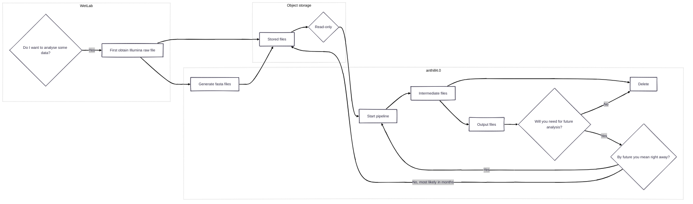

# Object Storage basic commands, tutorial

Last updated: 29.10.2026

## General Information

The new Object Storage server that is currently being implemented, is a type of sever that uses a different protocol to what we've been using so far: it is not a Linux server, but an Object Storage (S3) File System, available at <code>https://os.cent.uw.edu.pl</code>, that allows communication only through the AWS CLI tool. In the Object Storage there are no folders (and we can't create them): instead, we have something similar to a shared folder, called "buckets". Our lab was given two buckets:
1. lpcg-test-01 (quota : 100 GB): for test purposes. As of October 2026, this bucket contains some .txt and .fastq.gz files we used to test the communication between anthill4.0 and the OS system. I would recommend to use this as a playground to get familiar with this new system;
2. lpcg-01 (quota: 3 TB): this is where we will store input and final output files.

I will try to explain this better along the tutorial. It is a new concept for me too, so I plan to update this tutorial with everything I learn and discover, as to make your experience with it as painless as I can make it be.

## Objective

The Object Storage is intended to be an archive of data for inputs and ouputs. It is intended to communicate with anthill4.0 which will be used as the computational power. So the idea is the following:



## Set up your profile

The access to the OS system does not happen through <code>ssh</code>, but you will receive two secret keys nevertheless: one of them is a key that is basically your "username" (AWS_ACCESS_KEY_ID), the other your "password" (AWS_SECRET_ACCESS_KEY). As they are exceptionally long strings, it is not feasible to type them each time you have to communicate with the OS system so we will set up a hidden credentials file with your profile information.

First, download the [AWS CLI tool](https://docs.aws.amazon.com/cli/latest/userguide/getting-started-install.html):

```{bash}
curl -fsSL https://awscli.amazonaws.com/v2/install.sh | bash
```

Then, you have to save your username and password. You can do so in two ways:
1. By running <code>aws configure</code> and following the instructions. This will configure the "default" aws profile that is saved in the environment;
2. By locating the <code>credentials</code> file (it has no suffix!) and editing it manually. This allows for more customization, for example giving a "name" to your profile. This file is usually found in <code>~/.aws/</code> and you can edit it with any type of editor (<code>vim, nano...</code>); when editing, it should look like this:

  ```{bash}
  [default]
  aws_access_key_id = long_string
  aws_secret_access_key = even_loooonger_string
  ```
  
  You can add your credentials in the <code>\[default\]</code> profile: this is basically what happens when you use method 1, because <code>aws configure</code> overwrites this file. You can also create a profile with a custom name (for example mine is <code>\[fleotta\]</code>). Adding a name to your profile, though, makes stuff a little bit more complicated down the line because AWS CLI always uses the "default" settings, and will only access the information in a profile with a custom name only if the name is stated and passed as a flag in the commands. So, unless you have access to several S3 servers, I would recommend saving your credentials under the "default" profile.

> **VERY IMPORTANT: PRESERVE YOUR PRIVACY**
> After saving your credentials, it is VERY important to set the permissions of the <code>credentials</code> file in a way that no other use can access or modify that file. So remember to do ```chmod 600 credentials```!

## Basic commands
The commands that AWS cli uses are, more or less, pretty similar to what we are used to, but require a little bit of more work on our hand. You can copy a file with <code>cp</code> or delete one with <code>rm</code>. I want to stress one thing, though: you can't create folders, because the OS system **does not have directories/folders in the common sense**. So, how do we organise the data? In two ways:

- **fake folders**: a file can be saved with a name that resembles a path. For example, if I save my fasta file under the name <code>fastqs/NR103SS/library1.fastq.gz</code>, there won't be any "true" <code>fastqs</code> nor <code>NR103SS</code> folders (<code>fastqs</code> and <code>NR103SS</code> actually appear as 1 KB files), but this will allow us to organize them.
- **tags**: this is something I am still working on understanding, but basically it is a way to attach metadata to a file. You can potentially attach a tag with the sequencying run (i.e. NR103SS) to all the fastqs file coming from that run, and it would be a mock-up "folder" grouping together all fastqs files of sequencing run NR103SS.

### Transfer files (cp)
To copy a file from anthill4.0 to the OS system, use the following command:

```{bash}
aws --profile <your_profile_name>* --endpoint-url https://os.cent.uw.edu.pl s3 cp <file_to_copy> s3://<bucket_of_your_choice> upload: ./<file_to_copy> to s3://<bucket>/<new_name_of_file>
```

*remember, if you saved your credentials under the <code>\[default\]</code> profile, you don't need to provide any profile name.
Now, let's pretend we want to orgnaize our data in the "fake folder" NR103SS/ as described before. Here is how you would do that:

```{bash}
aws --profile <your_profile_name> --endpoint-url https://os.cent.uw.edu.pl s3 cp <file_to_copy> s3://<bucket_of_your_choice>/NR103SS/ upload: ./<file_to_copy> to s3://<bucket_of_your_choice>/NR103SS/<new_name_of_file>
```

To copy all files ending with <code>.fastq.gz</code> in a folder, the syntax is, again, slightly different from what we use. There are two methods:
1. The first one is rather straightforward, it is a for loop repeating the command seen before for each fastq file:
   ```{bash}
   for f in *.fastq.gz; do aws --profile fleotta --endpoint-url https://os.cent.uw.edu.pl s3 cp "$f" s3://lpcg-test-01/fastqs/NR103SS/ done
   ```
2. The second one uses additional flags:
   ```{bash}
   aws --profile <your_profile_name> --endpoint-url https://os.cent.uw.edu.pl s3 cp <source_folder> s3://<bucket_of_your_choice>/NR103SS/ --recursive --exclude "*" --include "*fastq.gz"
   ```

The behaviour of this command is the following: by default, <code>cp</code> wants to copy the whole folder (<code>cp source_folder --recursive</code>). Then we exclude all files (<code>--exclude "*"</code>) and re-include only the ones ending with the correct suffix (<code>--include "*fastq.gz"</code>). Here **the order** of the flags is **very important**.

### Display the contents of a bucket (ls)
This command is similar to the usual <code>ls</code>, but with extra steps:

```{bash}
aws --profile <your_profile_name> --endpoint-url https://os.cent.uw.edu.pl s3 ls s3://<bucket_of_your_choice>/ --recursive --human-readable
```

### Delete files
Lastly, to delete files, the command is:

```{bash}
aws --profile <your_profile_name> --endpoint-url https://os.cent.uw.edu.pl s3 rm s3://<bucket_of_your_choice>/<file_to_delete> delete: s3://<bucket_of_your_choice>/<file_to_delete>
```

### The OS and Nextflow pipelines
In a separate markdown file I will illustrate how to use the S3 OS system with Nextflow pipelines and how to schedule jobs on SLURM. See you there!
