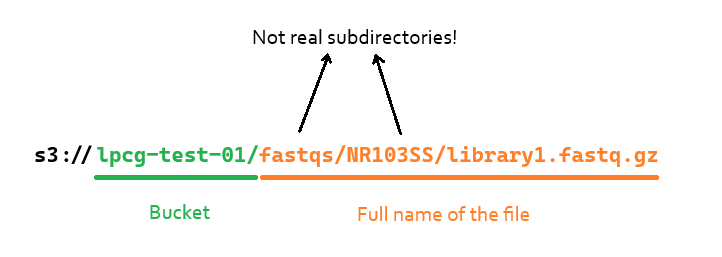

# Object Storage and Nextflow pipelines, tutorial

Last updated: 30.10.2026

## General Information

Now that you [set up your Object Storage (hereafter OS) profile](https://lpcg-ancientdna-warsaw.github.io/server-object_storage/OS_basic-commands), we can redirect Nextflow pipelines to use the files saved in the S3 buckets. I am going to show nf-core/eager behaviour, but these concepts are generally valid for any Nextflow pipeline.

### 1. Add the OS url to the configuration file
First thing first, we have to provide the Nextflow pipeline with information about our OS system characteristics. To do so, you can either add flags in the command line when running the pipeline (see [Nextflow documentation about aws flags](https://docs.seqera.io/nextflow/reference/config/aws)) or, more efficiently and I would argue also faster down the line, provide these flags in a configuration file. I plan to create a general configuration file for the whole laboratory, but until I do so, remember to provide these flags in your <code>.config</code> file:

```bash
aws {
    client {
        endpoint = 'https://os.cent.uw.edu.pl'
        s3PathStyleAccess = true
        connectionTimeout = 10000
    }
}
```

### General look of the paths
When providing the path to an input file, you have to remember two things: you have to point to the bucket where your file is saved, and you have to provide the file's **full name**. It will look as a path and it will feel like the file is saved in subdirectories, but as we specified in the [first tutorial](https://lpcg-ancientdna-warsaw.github.io/server-object_storage/OS_basic-commands), the OS system does **not** support subdirectories. That is simply the name of the file.



In nf-core/eager, for example, this will be needed in the input <code>.tsv</code> file, in the r1 and r2 path fields. Remember, if you do not provide the <code>aws.client.endpoint</code> url as seen previously in either the config file or the command line, the Nextflow pipeline will still not be able to locate the files.

## Expected behaviour
Now, your Nextflow pipeline should work smoothly: if you open the <code>.nextflow.log</code> file associated with your analysis, you should find a line like this:

```
Oct-29 11:37:59.192 [main] DEBUG nextflow.file.FileHelper - Started plugin 'nf-amazon' required to handle file: s3://lpcg-test-01/fastqs/NR103SS/library1.fastq.gz
```

If yes, then Nextflow has successfully recognised your path as an S3 bucket path and it initializes its own plugin that manages the handling of these files. It will print the following:

```
Oct-29 11:38:00.736 [FileTransfer-1] DEBUG nextflow.file.FilePorter - Copying foreign file s3://lpcg-test-01/fastqs/NR103SS/library1.fastq.gz to work dir: /path/to/work/internal/path/library1.fastq.gz
Oct-29 11:38:00.749 [FileTransfer-3] DEBUG n.cloud.aws.nio.S3FileSystemProvider - S3 download file from=s3://lpcg-test-01/fastqs/library1.fastq.gz to=/path/to/work/path/library1.fastq.gz size=97782479
```

There you will find where your downloaded files are saved. If you encounter any porblems with input files, I'd check that the file downloaded is not corrupted: I have noticed that the old version of nf-core/eager had a bug at this step, but it is not something an user can fix, only report to the developers.

>> **Minimizing duplicate downloads**
>>
>> In anthill4.0 we have to be careful about the quotas used: for this reason, we have to avoid downloading the same files multiple times. I am still looking for a way to provide a custom download folder (it seems, though, not possible), but for the time being always use the flag <code>-resume</code> to run a Nextflow pipeline: this will allow Nextflow to check for cached files and not download the same file twice (thrice, or more...).

### Bonus case: you do not use the "default" profile and you gave your profile a custom name
Now, if you run the pipeline and Nextflow sees that your input files are saved in an S3 client, it will access it by using the default secret credentials from <code>~/.aws/credentials</code>. Problem is, if you were foolish like me and gave your profile a custom name, then Nextflow will not be able to access the S3 client. Fortunately, the fix is pretty easy: in your <code>.sh</code> script that you use to schedule your Nextflow job, add this line:

```bash
export AWS_PROFILE='your_profile_name'
```

And that's all! If you encounter any problems, feel free to contact me, I'll do my best to help.
